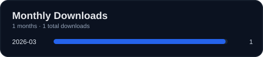

<h1 align="center">ok-infinity-nikki · ok-in</h1>

<p align="center">
  
</p>

Windows 上基于 [ok-script](https://github.com/ok-oldking/ok-script) 的《无限暖暖》图像识别与界面自动化项目，使用游戏窗口截图、OCR、模板匹配和模拟输入。

> 项目仍处于开发阶段。当前任务注册请以 [src/config.py](src/config.py) 为准；不应把旧版 ok-script 模板或其他游戏 README 中的功能宣传视为本项目已实现的能力。



## 源码运行

- Windows 10/11、Python **3.12**、[uv](https://docs.astral.sh/uv/)。
- 截图和 Windows 输入功能需要 Windows 环境，某些操作可能需要管理员权限。
- 游戏进程名：`X6Game-Win64-Shipping.exe`。

```powershell
git clone --recurse-submodules https://github.com/AliceJump/ok-infinity-nikki.git
cd ok-infinity-nikki
uv sync --locked
uv run --locked python main.py
# 调试启动：
uv run --locked python main_debug.py
```

## 目录组织

| 路径 | 内容 |
| --- | --- |
| `src/config.py` | 游戏窗口、OCR 与任务注册 |
| `src/tasks/` | 单次任务、剧情跳过与基础自动化逻辑 |
| `src/interaction/` | Windows 输入和位置辅助 |
| `src/image/`, `src/data/` | 图像处理及识别数据 |
| `assets/` | 运行时模板、COCO 特征数据 |
| `x-anylabeling-asset/` | 标注工程源文件（独立仓库迁移待完成） |
| `tests/` | 测试及历史图片样例 |
| `i18n/` | 本地化文件 |

## 开发与测试

依赖以 `pyproject.toml` 和 `uv.lock` 为准；`requirements.txt` 从 uv 导出，供 PyAppify 使用，不要直接编辑。

```powershell
.\run_tests.ps1
uv run --locked python -m compileall -q src main.py main_debug.py
```

`tests/TestMain.py` 仍是旧模板的图片测试示例，暂不作为 CI 门禁。需要真实《无限暖暖》截图和预期结果后才能迁移为有效测试。

完整目录、打包说明与标注素材仓库拆分步骤请看 [开发指南](docs/dev/DEVELOPMENT.md)。

## 发布

GitHub `v*` tag 触发 Windows CI、PyAppify 构建与 Release；开发期间先通过 PR 验证依赖、检查和构建。发布文件见 [Releases](https://github.com/AliceJump/ok-infinity-nikki/releases)。

## 免责声明

本项目仅供学习和交流，软件通过图像识别和常规 Windows 输入接口交互，不保证与游戏更新持续兼容。第三方自动化工具可能违反游戏服务协议，使用者自行了解和承担相关风险。
