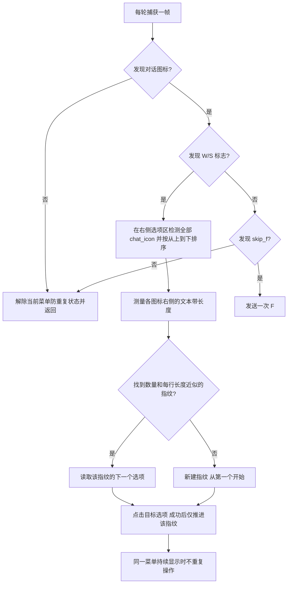

# 剧情跳过与选项记忆

`AutoSkipDialogTask` 是默认关闭的触发任务。启用后每 0.3 秒识别一帧，每轮最多点击一个选项或发送一次 F，然后返回 `False`。

- 指纹由选项数量和每一行的文本带长度共同组成，不同指纹各自记录进度。长度用图标高度归一化；逐行容差为 0.3 个图标高度或 5%，取较大值。
- 一个选项始终选第一个；两个选项按第一、第二、第一循环。其他数量同样按顺序循环。
- 菜单隐藏后保留各指纹进度；新指纹从零开始，已见过的指纹回到自己的下一项。记录仅存于本次任务实例内，不写入磁盘。
- 文本无法可靠测量时不操作；点击失败不推进。相同菜单仍显示时不连续切换选项。
- 不再滚轮交替选择；点击检测到的目标 `chat_icon`。退出门形图标不计入聊天选项。
- 已移除任务道具自动处理和 `skip_b` 后备操作。任务道具截图即使有新的 F 提示，也因缺少对话图标而不发送输入。
- 本地标注保持不变，阈值保持 0.9。W/S 在 3392×2400 原始截图通过；2048×1450 和 1280×906 的缩放回放不达阈值，因此不会自动选择。历史图标和 chat_icon 在七档尺寸通过。尚未做游戏实机点击验证。
