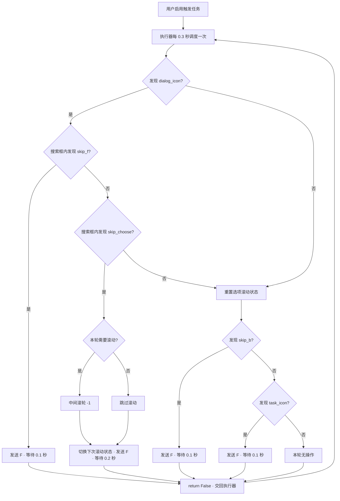

# 剧情跳过触发式任务流程

`AutoSkipDialogTask` 在 `trigger_tasks` 中注册；用户启用后，`ok-script 2.0.14` 以 `trigger_interval=0.3` 秒定期调度。任务每次只识别一帧、最多执行一个动作；结束时返回 `False`。

- `dialog_icon` 是 `skip_f` / `skip_choose` 的前置条件；`skip_b` / `task_icon` 与其独立。
- 模板资源由配套 PR #7 更新：对话图标和 W/S 提示使用真实 3392×2400 截图裁剪。检测使用各模板的缩放锚点坐标，不再传入固定 1920×1080 搜索框。两张截图在全部七档配置尺寸下已用 0.9 阈值回放验证；尚未进行游戏实机按键验证。
- `_scroll_on_next_choice` 使连续选项识别采用“滚动、跳过滚动、滚动……”序列；选择消失后重置。
- 触发任务默认禁用，由用户在触发任务页面手动开启；不在启动时自动发送按键。
- 注意：在开放世界中出现 `task_icon` 仍可能发送 F；这一行为与原任务一致，可后续增加场景验证或冷却。
